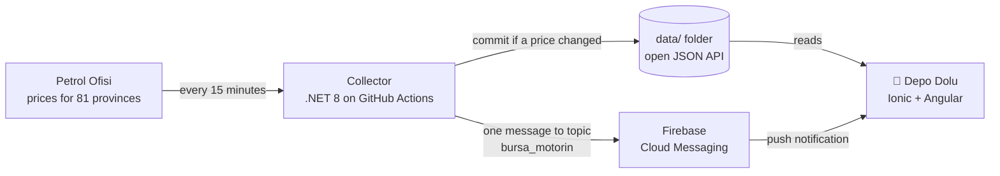

<div align="center">


# Depo Dolu

**English** | [Türkçe](README.tr.md)

**Real-time fuel price alerts for all 81 provinces of Turkey, plus a free open JSON API.**

[**▶ Try it on the web**](https://ozkurtomer.github.io/depo-dolu/) &nbsp;&nbsp; [**Free fuel price API**](#-free-fuel-price-api) &nbsp;&nbsp; [**How it works**](#%EF%B8%8F-how-it-works)

[](https://github.com/ozkurtomer/depo-dolu/actions/workflows/collect.yml)
[](data/)
[](https://github.com/ozkurtomer/depo-dolu/actions/workflows/ci.yml)
[](LICENSE)
[](https://github.com/ozkurtomer/depo-dolu/stargazers)

</div>

---

Fuel prices in Turkey change often, sometimes several times a week, and they change overnight. **Depo Dolu** ("full tank" in Turkish) watches the official list prices for every province and tells you the moment gasoline, diesel or LPG gets more expensive or cheaper where you live.

No accounts, no ads, no tracking. No servers either: the whole system runs for free on GitHub Actions and Firebase.

## ⛽ Today's prices

This table updates itself. Whenever a price changes, the collector rewrites it.

<!-- FIYATLAR:BASLA -->
| Province | Gasoline | Diesel | LPG |
|:---|---:|---:|---:|
| **İstanbul (Avrupa)** | 76.30 | 96.80 | 41.20 |
| **İstanbul (Anadolu)** | 76.10 | 96.60 | 40.60 |
| **Ankara** | 77.30 | 97.90 | 41.29 |
| **İzmir** | 77.50 | 98.10 | 41.20 |
| **Bursa** | 77.40 | 97.80 | 40.60 |
| **Antalya** | 78.50 | 99.20 | 41.40 |
| **Adana** | 78.10 | 98.70 | 41.61 |
| **Konya** | 78.30 | 99.00 | 41.29 |
| **Gaziantep** | 78.20 | 98.80 | 41.41 |
| **Kocaeli** | 76.70 | 97.10 | 40.40 |

<sub>Price per liter in Turkish lira (₺), VAT included. 🔺 increase / 🔻 decrease in the last 36 hours. Last update: Oct 25, 2026, 21:22 (Turkey time). [All 81 provinces](data/latest.json)</sub>
<!-- FIYATLAR:BITIR -->

---

## 📱 What it does

1. **Pick your province.** All 81 of them, with Istanbul's European and Asian sides listed separately.
2. **Pick your fuel.** Gasoline, diesel or LPG.
3. **Turn on alerts.** That's it.

When the price changes, you get a notification like this (the app is in Turkish):

> ⛽ **Bursa: Motorine zam** (Bursa: diesel price increase)
> Litre 97,80 → 99,10 ₺ (+1,30 ₺). 50 litrelik depo artık 4.955 ₺.

The app also shows how your province compares to the national average, the cheapest and most expensive provinces, what a full tank costs, and the price history.

<p align="center"></p>
<p align="center"><sub>The price history in the screenshots is sample data.</sub></p>

---

## 🔌 Free fuel price API

Use it in your own app, bot, dashboard or spreadsheet. No key, no sign-up, no rate limit. Prices are checked every 15 minutes.

| Endpoint | Contents |
|---|---|
| [`data/latest.json`](data/latest.json) | Current gasoline, diesel and LPG prices for 82 regions |
| `data/history/{province}.json` | Price history for one province, e.g. [`bursa.json`](data/history/bursa.json) |
| `data/changes.json` | The latest 300 price changes across Turkey |

Base URL:

```
https://raw.githubusercontent.com/ozkurtomer/depo-dolu/main/data/
```

<details>
<summary><b>curl</b></summary>

```bash
curl -s https://raw.githubusercontent.com/ozkurtomer/depo-dolu/main/data/latest.json \
  | jq '.prices.bursa'
```

```json
{
  "name": "Bursa",
  "benzin": 77.40,
  "motorin": 97.80,
  "lpg": 40.60,
  "changedAt": "2026-10-25T18:20:00+00:00"
}
```
</details>

<details>
<summary><b>JavaScript</b></summary>

```js
const url = 'https://raw.githubusercontent.com/ozkurtomer/depo-dolu/main/data/latest.json';
const { prices } = await fetch(url).then(r => r.json());
console.log(`Izmir gasoline: ${prices.izmir.benzin} TRY`);
```
</details>

<details>
<summary><b>C#</b></summary>

```csharp
using System.Net.Http.Json;
using System.Text.Json;

var url = "https://raw.githubusercontent.com/ozkurtomer/depo-dolu/main/data/latest.json";
var data = await new HttpClient().GetFromJsonAsync<JsonElement>(url);
var ankara = data.GetProperty("prices").GetProperty("ankara");
Console.WriteLine($"Ankara diesel: {ankara.GetProperty("motorin")} TRY");
```
</details>

<details>
<summary><b>Python</b></summary>

```python
import requests

url = "https://raw.githubusercontent.com/ozkurtomer/depo-dolu/main/data/latest.json"
prices = requests.get(url).json()["prices"]
print(f"Antalya LPG: {prices['antalya']['lpg']} TRY")
```
</details>

**Field names are Turkish:** `benzin` is gasoline (95 octane), `motorin` is diesel, `lpg` is autogas. All prices are in Turkish lira per liter, VAT included. Province keys are lowercase ASCII without Turkish characters: `istanbul-avrupa`, `istanbul-anadolu`, `sanliurfa`, `canakkale`… They never change. The full schema is documented in [data/README.md](data/README.md) (in Turkish).

Built something with this data? Open an issue and tell us, we'll link it here.

---

## ⚙️ How it works

No servers. Everything runs on the free tiers of GitHub Actions and Firebase.



- **Zero personal data.** Each phone subscribes to a topic such as `bursa_motorin`. The server never knows who is subscribed.
- **No false alarms.** If the page loads partially, fewer than 75 provinces are read, or a price jumps more than 20% at once, the collector stops without writing anything. Nobody gets a bogus "prices went up" notification.
- **No noise commits.** If nothing changed, no file is touched. The git history of this repo *is* the history of fuel price changes in Turkey.
- **Data source.** Official per-province list prices published by Petrol Ofisi, Turkey's largest fuel distributor.

<details>
<summary><b>Project structure</b></summary>

```
depo-dolu/
├── collector/                     .NET 8 collector (zero NuGet dependencies)
│   ├── DepoDolu.Collector/        PoParser, PriceStore, FcmNotifier, TelegramNotifier, ReadmeUpdater
│   └── DepoDolu.Collector.Tests/  xUnit tests with a snapshot of real prices
├── app/                           Ionic 8 + Angular 19 + Capacitor 7 mobile app
├── data/                          Price data (the open API)
├── tools/                         Test fixture generator
└── .github/workflows/
    ├── collect.yml                Collects prices every 15 minutes
    ├── pages.yml                  Publishes the web demo
    └── ci.yml                     Tests and builds
```
</details>

---

## 🛠 Run it yourself

```bash
git clone https://github.com/ozkurtomer/depo-dolu.git
cd depo-dolu

# The app, in your browser
cd app && npm install && npm start

# The collector, offline against the bundled test page
dotnet run --project collector/DepoDolu.Collector -- --data /tmp/data \
  --html collector/DepoDolu.Collector.Tests/Fixtures/po-2026-10-25.html

# Tests
dotnet test collector/DepoDolu.sln
```

<details>
<summary><b>Running your own copy (fork, Firebase, Android, Telegram)</b></summary>

1. Fork the repo and set your username in `app/src/app/config.ts`.
2. **Settings → Actions → General → Workflow permissions:** choose **Read and write**.
3. Create a Firebase project. Under **Project settings → Service accounts → Generate new private key**, download the JSON and add its contents as a repository secret named `FIREBASE_SERVICE_ACCOUNT`.
4. Add an Android app in Firebase (package name: `appId` in `app/capacitor.config.ts`) and put `google-services.json` into `app/android/app/`.
5. Build the Android app:
   ```bash
   cd app
   npx cap add android
   npm run cap:sync
   npx cap open android
   ```
6. Web demo: **Settings → Pages → Source: GitHub Actions**.
7. Telegram channel (optional): create a bot with BotFather and make it an admin of your channel. Add the bot token as the `TELEGRAM_BOT_TOKEN` secret and the channel name (e.g. `@depodolu`) as a repository **variable** named `TELEGRAM_CHAT_ID`.
</details>

---

## 🗺 Roadmap

- [ ] Publish the Android app on Google Play
- [ ] **Early warning:** notify about announced price hikes before they hit the pump
- [x] Telegram channel: every change is posted as one summary message (active once the channel is set up)
- [ ] X (Twitter) bot
- [ ] Add Opet and Shell prices and show the cheapest distributor per province
- [ ] District-level prices
- [ ] Home screen widget

## 🤝 Contributing

Contributions of any size are welcome: new distributors, district support, design, translations, bug reports. See [CONTRIBUTING.md](CONTRIBUTING.md) (in Turkish; issues and PRs in English are fine) and the [`good first issue`](https://github.com/ozkurtomer/depo-dolu/labels/good%20first%20issue) label.

If you find this useful, please ⭐ the repo. It helps more people find it.

---

<sub>Prices are the per-province list prices published on Petrol Ofisi's public website, VAT included. Individual stations may differ slightly. This project is not affiliated with Petrol Ofisi. License: [MIT](LICENSE). Made by [Ömer Özkurt](https://github.com/ozkurtomer).</sub>
