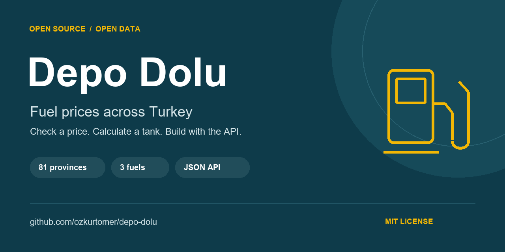
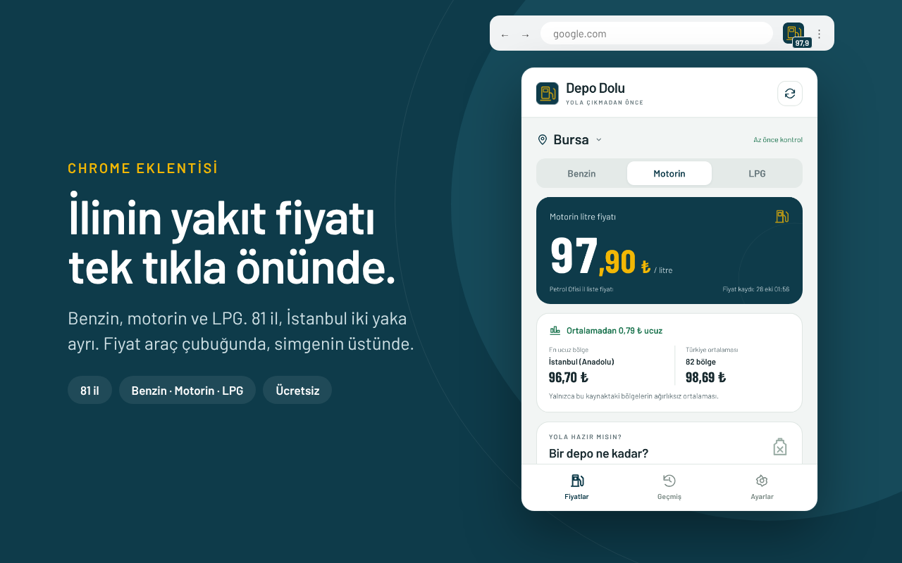
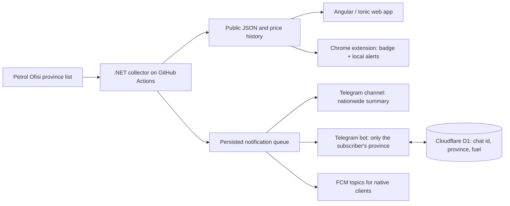

<div align="center">



# Depo Dolu

**English** · [Türkçe](README.tr.md)

**Fuel prices for all 81 provinces of Turkey. Check a price, calculate a tank, share it, or build with the open JSON API.**

[Try the web app](https://ozkurtomer.github.io/depo-dolu/) · [Chrome extension](#chrome-extension) · [Use the API](docs/API.md) · [Code examples](examples/README.md) · [Telegram alerts](https://t.me/depodolu_bot) · [Contribute](CONTRIBUTING.md)

[](https://github.com/ozkurtomer/depo-dolu/actions/workflows/ci.yml)
[](https://github.com/ozkurtomer/depo-dolu/actions/workflows/collect.yml)
[](LICENSE)
[](https://github.com/ozkurtomer/depo-dolu/stargazers)

</div>

Fuel prices are easier to understand when you can see what they mean for your own tank. Depo Dolu brings province prices, comparisons, history and alerts together in a small, open-source project. No account or advertising in the app.

## Try it in a minute

1. [Open the app](https://ozkurtomer.github.io/depo-dolu/) and choose a province and fuel.
2. Compare the price with other regions and choose your tank size.
3. Use **“Bu fiyatı paylaş”** to share the price and a link that opens the same province and fuel.

Example: [Bursa · diesel](https://ozkurtomer.github.io/depo-dolu/?il=bursa&yakit=motorin). For alerts without installing anything, open [@depodolu_bot](https://t.me/depodolu_bot) on Telegram and type your province: you only hear about your own province and fuel. The [@depodolu](https://t.me/depodolu) channel posts a nationwide summary.

<p align="center"></p>
<p align="center"><sub>Illustrative app overview; the history shown is sample data. The live demo contains the actual collected history.</sub></p>

## What is available?

| For drivers | For developers |
| --- | --- |
| Gasoline, diesel and LPG in 81 provinces (82 regions) | Public JSON, no API key or account |
| Tank cost, region comparison and price history | .NET collector with no production NuGet dependencies |
| Shareable province and fuel links | Angular + Ionic web client, ready for further native work |
| Personal Telegram alerts for your province ([@depodolu_bot](https://t.me/depodolu_bot)) | FCM topics, Telegram bot on Cloudflare Workers + D1 ([bot/](bot/README.md)), retry queue and tests |

**Current scope:** prices come from Petrol Ofisi province lists. Checks are scheduled every 15 minutes, can be delayed, and do not guarantee instant alerts. The [Chrome extension](#chrome-extension) is ready for the Chrome Web Store; native mobile distribution is [planned](docs/ROADMAP.md). The web app does not receive push alerts.

## Chrome extension

<p align="center"></p>

Your province's price on the toolbar, one click away. Pick a province and fuel; the price per litre sits on the icon badge. The popup shows the tank cost (30–70 L), how you compare with the national average, price history and a link to the Telegram bot. Optional desktop alerts fire when your selected price changes.

No account, no ads, no analytics, no content scripts. Choices stay in `chrome.storage.local`; the only network requests are the public JSON files in this repository. Manifest V3, no build step, no npm dependencies.

- **Chrome Web Store:** the listing is under review. The link will be added here once it is published.
- **Install from source now:** `chrome://extensions` → Developer mode → **Load unpacked** → choose the `extension/` folder.
- [Extension guide and local test scenarios](extension/README.md) · [Privacy](extension/PRIVACY.md) · [Store release guide](extension/STORE.md)

## Latest stored prices

This table is maintained by the collector. Its date is the last stored update, not the last successful check.

<!-- FIYATLAR:BASLA -->
| Province | Gasoline | Diesel | LPG |
|:---|---:|---:|---:|
| **İstanbul (Avrupa)** | 76.30 | 🔺 96.90 | 41.20 |
| **İstanbul (Anadolu)** | 🔺 76.20 | 🔺 96.70 | 40.60 |
| **Ankara** | 77.30 | 🔺 98.00 | 41.29 |
| **İzmir** | 🔺 77.60 | 🔺 98.30 | 41.20 |
| **Bursa** | 🔺 77.50 | 🔺 97.90 | 40.60 |
| **Antalya** | 🔺 78.60 | 🔺 99.30 | 41.40 |
| **Adana** | 🔺 78.20 | 🔺 98.80 | 41.61 |
| **Konya** | 🔺 78.40 | 🔺 99.10 | 41.29 |
| **Gaziantep** | 🔺 78.30 | 🔺 98.90 | 41.41 |
| **Kocaeli** | 🔺 76.80 | 🔺 97.20 | 40.40 |

<sub>Price per liter in Turkish lira (₺), VAT included. 🔺 increase / 🔻 decrease in the last 36 hours. Last update: Oct 28, 2026, 01:56 (Turkey time). [All 81 provinces](data/latest.json)</sub>

**Latest price changes**

- 🔺 Oct 28, 2026, 01:56: **İstanbul (Avrupa)** diesel 96.80 → 96.90 ₺ (+0.10)
- 🔺 Oct 28, 2026, 01:56: **İstanbul (Anadolu)** gasoline 76.10 → 76.20 ₺ (+0.10)
- 🔺 Oct 28, 2026, 01:56: **İstanbul (Anadolu)** diesel 96.60 → 96.70 ₺ (+0.10)
- 🔺 Oct 28, 2026, 01:56: **Ankara** diesel 97.90 → 98.00 ₺ (+0.10)
- 🔺 Oct 28, 2026, 01:56: **İzmir** gasoline 77.50 → 77.60 ₺ (+0.10)
<!-- FIYATLAR:BITIR -->

## Build with the data

```js
const url = 'https://raw.githubusercontent.com/ozkurtomer/depo-dolu/main/data/latest.json';
const response = await fetch(url);
if (!response.ok) throw new Error(`Price data unavailable: ${response.status}`);
const { prices, updatedAt } = await response.json();
console.log(prices.bursa.motorin, updatedAt); // TRY per litre, last stored update
```

| File | Contents |
| --- | --- |
| [`latest.json`](data/latest.json) | Current prices for every region |
| [`history/bursa.json`](data/history/bursa.json) | A province's stored price history |
| [`changes.json`](data/changes.json) | Latest individual price changes; empty until a change is recorded |

`benzin` = gasoline, `motorin` = diesel, `lpg` = autogas. All prices are TRY per litre, VAT included. Hosting is subject to GitHub availability and usage limits. See [API fields, timestamps and sharing links](docs/API.md).

**Ready-to-run examples:** [Python and Node.js](examples/README.md), including an offline mode using the bundled data. No third-party packages required.

Built something with this data? [Tell us in an issue](https://github.com/ozkurtomer/depo-dolu/issues/new) so others can discover it.

## Run locally

Requires **Node.js 22.18+** and **.NET 8 SDK**. From the repository root:

```bash
git clone https://github.com/ozkurtomer/depo-dolu.git
cd depo-dolu
cd app
npm ci
npm start
```

Open `http://localhost:4200`. Development uses the bundled local `data/` directory; no Firebase account is needed.

In another terminal, from the repository root:

```bash
dotnet test collector/DepoDolu.sln
dotnet run --project collector/DepoDolu.Collector -- --data .local-data --html collector/DepoDolu.Collector.Tests/Fixtures/po-2026-10-25.html --dry-run
```

App checks, from `app/`:

```bash
npm test
npm run build
```

## How it works



Validation rejects missing fuel values, duplicate or unknown province rows, too few rows and large detected jumps. Failed configured notification deliveries stay queued for retry. This reduces errors; it is not a guarantee of price accuracy or exactly-once delivery. [Operation and fork setup](docs/OPERATIONS.md).

The app stores selections and a last-price cache on the device. This repository does not collect user accounts; Firebase and Telegram process their own service data. The Telegram bot stores only the chat ID and the chosen province and fuel in Cloudflare D1, never in this repository; `/durdur` deletes the record. [Security notes](SECURITY.md).

## Help it grow

Try it, share a province link, report a reproducible bug, or build an API example. A star helps other developers discover the project if you find it useful.

- [Contributing guide](CONTRIBUTING.md) — English and Turkish, with checks to run.
- [Roadmap and first contribution ideas](docs/ROADMAP.md) — Android, iOS and more data sources.
- [Help](SUPPORT.md) · [Community guidelines](CODE_OF_CONDUCT.md) · [Changelog](CHANGELOG.md).
- Maintainers: [GitHub setup](docs/GITHUB_SETUP.md) · [Launch checklist](docs/LAUNCH.md).

---

Prices are Petrol Ofisi's public province list prices, not an all-station market average; individual pump prices may differ. This project is not affiliated with Petrol Ofisi. Code license: [MIT](LICENSE). By [Ömer Özkurt](https://github.com/ozkurtomer).
