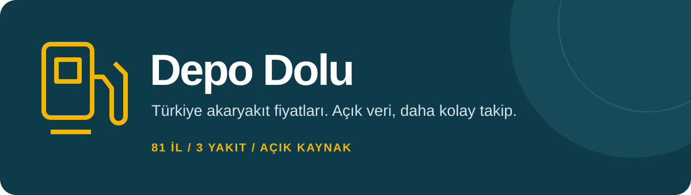
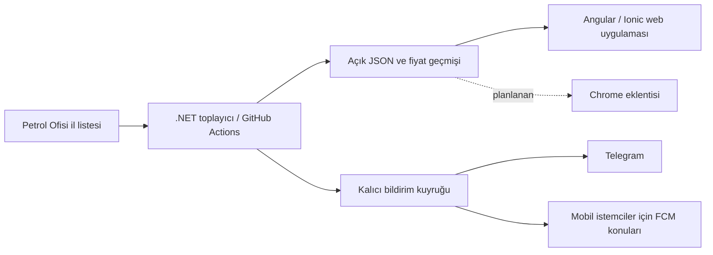

<div align="center">



# Depo Dolu

[English](README.md) · **Türkçe**

**81 ilde akaryakıt fiyatları. Fiyatı gör, depo maliyetini hesapla, paylaş veya açık JSON API ile kendi uygulamanı geliştir.**

[Web'de dene](https://ozkurtomer.github.io/depo-dolu/) · [API'yi kullan](data/README.md) · [Telegram bildirimleri](https://t.me/depodolu) · [Katkı ver](CONTRIBUTING.md)

[](https://github.com/ozkurtomer/depo-dolu/actions/workflows/ci.yml)
[](https://github.com/ozkurtomer/depo-dolu/actions/workflows/collect.yml)
[](LICENSE)
[](https://github.com/ozkurtomer/depo-dolu/stargazers)

</div>

Litre fiyatının kendi depomuz için ne anlama geldiğini görmek daha faydalı. Depo Dolu; il fiyatını, karşılaştırmayı, geçmişi ve bildirimleri küçük, açık kaynak bir projede birleştirir. Uygulamada hesap açma ve reklam yok.

## Bir dakikada dene

1. [Uygulamayı aç](https://ozkurtomer.github.io/depo-dolu/), ilini ve yakıtını seç.
2. Fiyatı diğer bölgelerle karşılaştır, depo litresini seç.
3. **“Bu fiyatı paylaş”** düğmesiyle fiyatı ve aynı il/yakıtı açan bağlantıyı paylaş.

Örnek: [Bursa · motorin](https://ozkurtomer.github.io/depo-dolu/?il=bursa&yakit=motorin). Uygulama kurmadan bildirim almak için Telegram'da [@depodolu](https://t.me/depodolu) kanalını takip et.

<p align="center"></p>
<p align="center"><sub>Uygulamanın örnek görünümü; görseldeki fiyat geçmişi örnek veridir. Gerçek birikmiş geçmiş web demosundadır.</sub></p>

## Neler var?

| Sürücüler için | Geliştiriciler için |
| --- | --- |
| 81 il, 82 bölge için benzin, motorin ve LPG | Anahtarsız, hesapsız, herkese açık JSON |
| Depo maliyeti, bölge karşılaştırması ve fiyat geçmişi | Üretimde NuGet bağımlılığı olmayan .NET toplayıcı |
| İl ve yakıt seçimini taşıyan paylaşım bağlantıları | Angular + Ionic web uygulaması |
| Telegram özetleri | FCM konuları, kalıcı bildirim kuyruğu ve testler |

**Mevcut kapsam:** fiyatlar Petrol Ofisi'nin il listesinden alınır. Kontroller 15 dakikalık aralıklarla planlanır; gecikebilir, anlık bildirim garantisi yoktur. Mobil uygulamanın dağıtımı ve Chrome eklentisi [planlanıyor](docs/ROADMAP.md); henüz yayımlanmış değiller. Web sürümü push bildirimi almaz.

## Son kaydedilen fiyatlar

Bu tabloyu toplayıcı günceller. Tarih, son veri güncellemesini gösterir; son başarılı kontrolü göstermez.

<!-- FIYATLAR:BASLA -->
| İl | Benzin | Motorin | LPG |
|:---|---:|---:|---:|
| **İstanbul (Avrupa)** | 76,30 | 96,80 | 41,20 |
| **İstanbul (Anadolu)** | 76,10 | 96,60 | 40,60 |
| **Ankara** | 77,30 | 97,90 | 41,29 |
| **İzmir** | 77,50 | 98,10 | 41,20 |
| **Bursa** | 77,40 | 97,80 | 40,60 |
| **Antalya** | 78,50 | 99,20 | 41,40 |
| **Adana** | 78,10 | 98,70 | 41,61 |
| **Konya** | 78,30 | 99,00 | 41,29 |
| **Gaziantep** | 78,20 | 98,80 | 41,41 |
| **Kocaeli** | 76,70 | 97,10 | 40,40 |

<sub>Litre fiyatı, KDV dahil, ₺. 🔺 zam / 🔻 indirim: son 36 saat. Son güncelleme: 25 Ekim 2026, 21:22. [81 ilin tamamı](data/latest.json)</sub>
<!-- FIYATLAR:BITIR -->

## Veriyi kendi projende kullan

```js
const url = 'https://raw.githubusercontent.com/ozkurtomer/depo-dolu/main/data/latest.json';
const response = await fetch(url);
if (!response.ok) throw new Error(`Fiyat verisi alınamadı: ${response.status}`);
const { prices, updatedAt } = await response.json();
console.log(prices.bursa.motorin, updatedAt); // TL/litre, son veri güncellemesi
```

| Dosya | İçerik |
| --- | --- |
| [`latest.json`](data/latest.json) | Tüm bölgelerin son fiyatları |
| [`history/bursa.json`](data/history/bursa.json) | Bir ilin fiyat geçmişi |
| [`changes.json`](data/changes.json) | Son fiyat değişiklikleri; ilk değişikliğe kadar boş liste |

Fiyatlar TL/litre ve KDV dahildir. GitHub'ın erişilebilirlik, önbellek ve kullanım sınırları geçerlidir. [Türkçe veri rehberi](data/README.md) · [English API reference](docs/API.md).

Bu veriyle bir şey geliştirdiysen [issue açıp anlat](https://github.com/ozkurtomer/depo-dolu/issues/new); başkaları da keşfetsin.

## Yerel çalıştırma

**Node.js 22.18+** ve **.NET 8 SDK** gerekir. Repo kökünden:

```bash
git clone https://github.com/ozkurtomer/depo-dolu.git
cd depo-dolu
cd app
npm ci
npm start
```

`http://localhost:4200` adresini aç. Geliştirme sürümü yerel `data/` klasörünü kullanır; Firebase hesabı gerekmez.

Başka bir terminalde, repo kökünden:

```bash
dotnet test collector/DepoDolu.sln
dotnet run --project collector/DepoDolu.Collector -- --data .local-data --html collector/DepoDolu.Collector.Tests/Fixtures/po-2026-10-25.html --dry-run
```

Uygulama kontrolleri, `app/` klasöründen:

```bash
npm test
npm run build
```

## Nasıl çalışır?



Eksik yakıt fiyatı, tekrarlanan veya tanınmayan il satırı, az sayıda satır ve büyük fiyat sıçraması reddedilir. Ayarlanmış kanallarda başarısız olan bildirimler sonraki çalıştırmada tekrar denenir. Bu önlemler fiyat doğruluğunu veya bir mesajın yalnızca bir kez teslimini garanti etmez. [İşletim ve fork kurulumu](docs/OPERATIONS.md).

Seçimler ve son fiyat önbelleği cihazda tutulur. Bu repo kullanıcı hesabı toplamaz; Firebase ve Telegram kendi hizmet verilerini işler. [Güvenlik notları](SECURITY.md).

## Birlikte büyütelim

Uygulamayı dene, bir ilin fiyat bağlantısını paylaş, tekrarlanabilir bir hata bildir veya API örneği yaz. İşine yaradıysa vereceğin ⭐ başka geliştiricilerin projeyi keşfetmesine yardımcı olur.

- [Katkı rehberi](CONTRIBUTING.md) — Türkçe ve İngilizce başlangıç bilgileri.
- [Yol haritası ve ilk katkı fikirleri](docs/ROADMAP.md) — Android, Chrome eklentisi ve yeni kaynaklar.
- [Değişiklikler](CHANGELOG.md) · [Tanıtım kontrol listesi](docs/LAUNCH.md).

---

Veri, Petrol Ofisi il liste fiyatlarıdır; tüm istasyonların piyasa ortalaması değildir. Pompa fiyatları farklı olabilir. Proje Petrol Ofisi ile bağlantılı değildir. Kod lisansı: [MIT](LICENSE). Geliştiren: [Ömer Özkurt](https://github.com/ozkurtomer).
