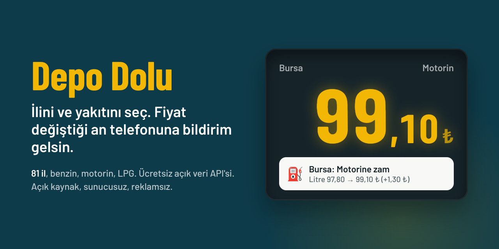
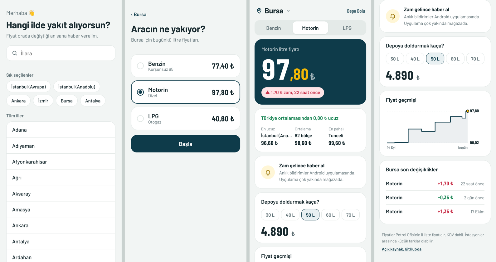
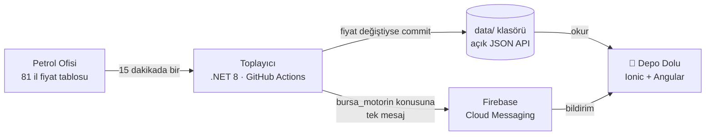

<div align="center">



# Depo Dolu

[English](README.md) | **Türkçe**

**Türkiye'nin 81 ilinde benzin, motorin ve LPG fiyatı değiştiği an haberin olsun.**

[**▶ Web'de dene**](https://ozkurtomer.github.io/depo-dolu/) &nbsp;&nbsp; [**Ücretsiz fiyat API'si**](#-ücretsiz-akaryakıt-fiyat-apisi) &nbsp;&nbsp; [**Nasıl çalışır?**](#-nasıl-çalışır)

[](https://github.com/ozkurtomer/depo-dolu/actions/workflows/collect.yml)
[](data/)
[](https://github.com/ozkurtomer/depo-dolu/actions/workflows/ci.yml)
[](LICENSE)
[](https://github.com/ozkurtomer/depo-dolu/stargazers)

</div>

---

## ⛽ Bugünkü fiyatlar

Bu tablo kendiliğinden güncellenir. Fiyat değiştiği an toplayıcı burayı yeniden yazar.

<!-- FIYATLAR:BASLA -->
| İl | Benzin | Motorin | LPG |
|:---|---:|---:|---:|
| **İstanbul (Avrupa)** | 76,30 | 96,80 | 41,20 |
| **İstanbul (Anadolu)** | 76,10 | 96,60 | 40,60 |
| **Ankara** | 77,30 | 97,90 | 41,29 |
| **İzmir** | 77,50 | 98,10 | 41,20 |
| **Bursa** | 77,40 | 97,80 | 40,60 |
| **Antalya** | 78,50 | 99,20 | 41,40 |
| **Adana** | 78,10 | 98,70 | 41,61 |
| **Konya** | 78,30 | 99,00 | 41,29 |
| **Gaziantep** | 78,20 | 98,80 | 41,41 |
| **Kocaeli** | 76,70 | 97,10 | 40,40 |

<sub>Litre fiyatı, KDV dahil, ₺. 🔺 zam / 🔻 indirim: son 36 saat. Son güncelleme: 25 Ekim 2026, 21:22. [81 ilin tamamı](data/latest.json)</sub>
<!-- FIYATLAR:BITIR -->

---

## 📱 Ne yapar?

1. **İlini seç.** 81 il, İstanbul'un iki yakası ayrı.
2. **Yakıtını seç.** Benzin, motorin ya da LPG.
3. **Bildirimi aç.** Hepsi bu. Hesap yok, kayıt yok, reklam yok.

Fiyat değişince telefonuna şöyle bir bildirim düşer:

> ⛽ **Bursa: Motorine zam**
> Litre 97,80 → 99,10 ₺ (+1,30 ₺). 50 litrelik depo artık 4.955 ₺.

<p align="center"></p>
<p align="center"><sub>Ekran görüntülerindeki fiyat geçmişi örnek veridir.</sub></p>

---

## 🔌 Ücretsiz akaryakıt fiyat API'si

Kendi uygulamanda, botunda ya da Excel'inde kullan. Anahtar yok, kayıt yok, limit yok. Veri her 15 dakikada bir kontrol edilir.

| Adres | İçerik |
|---|---|
| [`data/latest.json`](data/latest.json) | 82 bölgenin güncel benzin, motorin, LPG fiyatı |
| `data/history/{il}.json` | O ilin fiyat geçmişi, ör. [`bursa.json`](data/history/bursa.json) |
| `data/changes.json` | Türkiye genelinde son 300 fiyat değişikliği |

Temel adres:

```
https://raw.githubusercontent.com/ozkurtomer/depo-dolu/main/data/
```

<details>
<summary><b>curl</b></summary>

```bash
curl -s https://raw.githubusercontent.com/ozkurtomer/depo-dolu/main/data/latest.json \
  | jq '.prices.bursa'
```

```json
{
  "name": "Bursa",
  "benzin": 77.40,
  "motorin": 97.80,
  "lpg": 40.60,
  "changedAt": "2026-10-25T18:20:00+00:00"
}
```
</details>

<details>
<summary><b>JavaScript</b></summary>

```js
const url = 'https://raw.githubusercontent.com/ozkurtomer/depo-dolu/main/data/latest.json';
const { prices } = await fetch(url).then(r => r.json());
console.log(`İzmir benzin: ${prices.izmir.benzin} ₺`);
```
</details>

<details>
<summary><b>C#</b></summary>

```csharp
using System.Net.Http.Json;
using System.Text.Json;

var url = "https://raw.githubusercontent.com/ozkurtomer/depo-dolu/main/data/latest.json";
var data = await new HttpClient().GetFromJsonAsync<JsonElement>(url);
var ankara = data.GetProperty("prices").GetProperty("ankara");
Console.WriteLine($"Ankara motorin: {ankara.GetProperty("motorin")} ₺");
```
</details>

<details>
<summary><b>Python</b></summary>

```python
import requests

url = "https://raw.githubusercontent.com/ozkurtomer/depo-dolu/main/data/latest.json"
prices = requests.get(url).json()["prices"]
print(f"Antalya LPG: {prices['antalya']['lpg']} ₺")
```
</details>

İl anahtarları Türkçe karakter içermez: `istanbul-avrupa`, `istanbul-anadolu`, `sanliurfa`, `canakkale`… Tam liste için `latest.json` içindeki anahtarlara bak. Ayrıntılar [data/README.md](data/README.md) dosyasında.

Bu veriyle bir şey yaptıysan bir issue açıp anlat, buraya ekleyelim.

---

## ⚙️ Nasıl çalışır?

Sunucu yok. Bütün sistem GitHub Actions ve Firebase'in ücretsiz katmanında çalışır; aylık maliyeti 0 ₺.



- **Kişisel veri sıfır.** Telefon `bursa_motorin` gibi bir konuya abone olur. Sunucu kimin abone olduğunu bilmez.
- **Yanlış alarm yok.** Sayfa yarım gelirse, 75'ten az il okunursa ya da bir fiyat tek seferde %20'den fazla oynarsa toplayıcı hiçbir şey yazmadan durur. Binlerce kişiye yanlış "zam geldi" bildirimi gitmez.
- **Gereksiz commit yok.** Fiyat değişmediyse hiçbir dosyaya dokunulmaz. Repo geçmişi, Türkiye'nin akaryakıt zam geçmişinin kendisidir.

<details>
<summary><b>Proje yapısı</b></summary>

```
depo-dolu/
├── collector/                     .NET 8 toplayıcı (sıfır NuGet bağımlılığı)
│   ├── DepoDolu.Collector/        PoParser, PriceStore, FcmNotifier, ReadmeUpdater
│   └── DepoDolu.Collector.Tests/  xUnit testleri, gerçek fiyatlarla test sayfası
├── app/                           Ionic 8 + Angular 19 + Capacitor 7 mobil uygulama
├── data/                          Fiyat verisi (açık API)
├── tools/                         Test sayfası üretici
└── .github/workflows/
    ├── collect.yml                15 dakikada bir fiyat toplama
    ├── pages.yml                  Web demosunu yayınlama
    └── ci.yml                     Testler ve build
```
</details>

---

## 🛠 Kendin çalıştır

```bash
git clone https://github.com/ozkurtomer/depo-dolu.git
cd depo-dolu

# Mobil uygulama (tarayıcıda)
cd app && npm install && npm start

# Toplayıcı (siteye istek atmadan, test sayfasıyla)
dotnet run --project collector/DepoDolu.Collector -- --data /tmp/data \
  --html collector/DepoDolu.Collector.Tests/Fixtures/po-2026-10-25.html

# Testler
dotnet test collector/DepoDolu.sln
```

<details>
<summary><b>Kendi kopyanı kurmak (fork + Firebase + Android)</b></summary>

1. Repoyu fork'la. `app/src/app/config.ts` içindeki kullanıcı adını kendininkiyle değiştir.
2. **Settings → Actions → General → Workflow permissions** altında **Read and write** seç.
3. Firebase'de proje aç. **Project settings → Service accounts → Generate new private key** ile JSON indir, içeriğini `FIREBASE_SERVICE_ACCOUNT` adıyla repo secret'ı olarak ekle.
4. Firebase'e Android uygulaması ekle (paket adı: `app/capacitor.config.ts` içindeki `appId`). `google-services.json` dosyasını `app/android/app/` içine koy.
5. Şunları çalıştır:
   ```bash
   cd app
   npx cap add android
   npm run cap:sync
   npx cap open android
   ```
6. Web demosu için: **Settings → Pages → Source: GitHub Actions**.
7. Telegram kanalı için: BotFather'dan bot aç, botu kanalına yönetici yap. Bot anahtarını `TELEGRAM_BOT_TOKEN` secret'ı, kanal adını (ör. `@depodolu`) `TELEGRAM_CHAT_ID` adlı **variable** olarak ekle.
</details>

---

## 🗺 Yol haritası

- [ ] Android uygulamasını Play Store'a çıkarmak
- [ ] **Zam öncesi uyarı:** "Bu gece motorine zam geliyor" haberlerini pompaya yansımadan önce bildirmek
- [x] Telegram kanalı: her zam tek özet mesajla kanala düşer (kanal açılınca etkin)
- [ ] X (Twitter) botu
- [ ] Opet ve Shell fiyatlarını eklemek, ildeki en ucuz dağıtıcıyı göstermek
- [ ] İlçe bazında fiyat
- [ ] Ana ekran widget'ı

## 🤝 Katkı

Her türlü katkıya açığız: yeni dağıtıcı, ilçe desteği, tasarım, çeviri, hata bildirimi. Başlamak için [CONTRIBUTING.md](CONTRIBUTING.md) dosyasına ve [`good first issue`](https://github.com/ozkurtomer/depo-dolu/labels/good%20first%20issue) etiketli işlere bak.

İşine yaradıysa ⭐ vermeyi unutma. Daha çok kişinin görmesini sağlıyor.

---

<sub>Fiyatlar Petrol Ofisi'nin herkese açık sayfasındaki il liste fiyatlarıdır (KDV dahil). İstasyonlar arasında küçük farklar olabilir. Bu proje Petrol Ofisi ile bağlantılı değildir. Lisans: [MIT](LICENSE). Geliştiren: [Ömer Özkurt](https://github.com/ozkurtomer).</sub>
